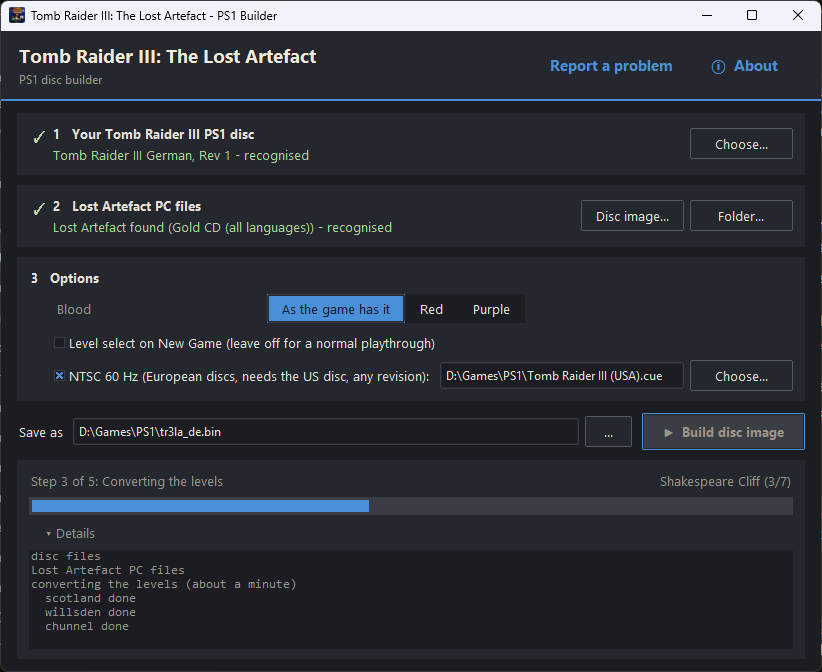
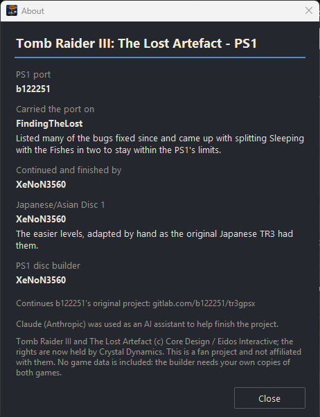
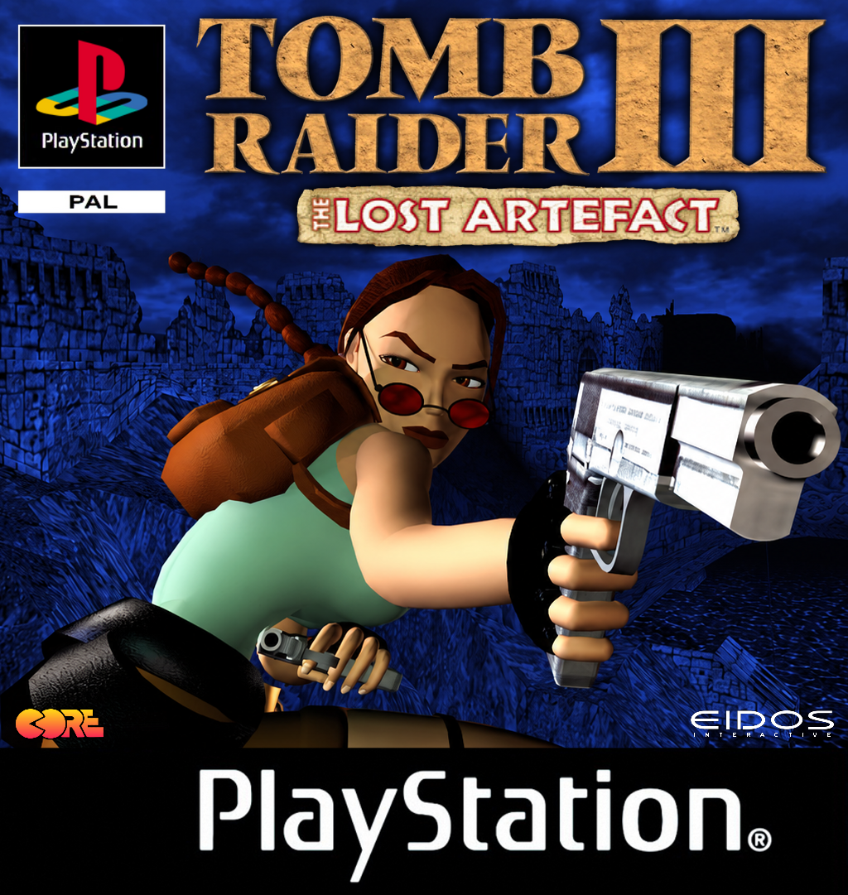
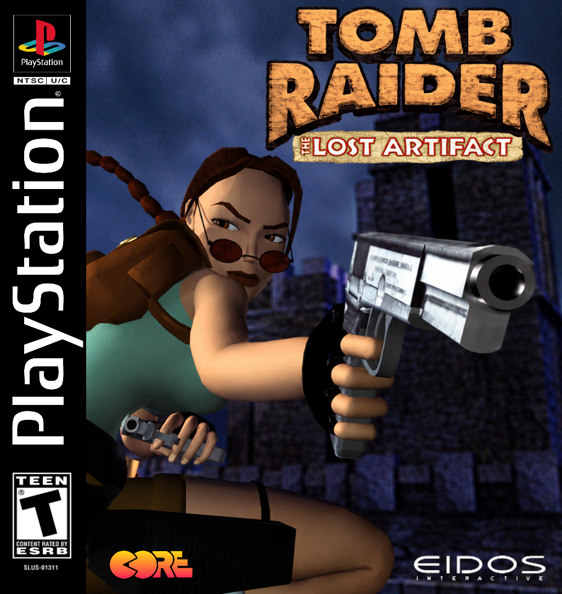
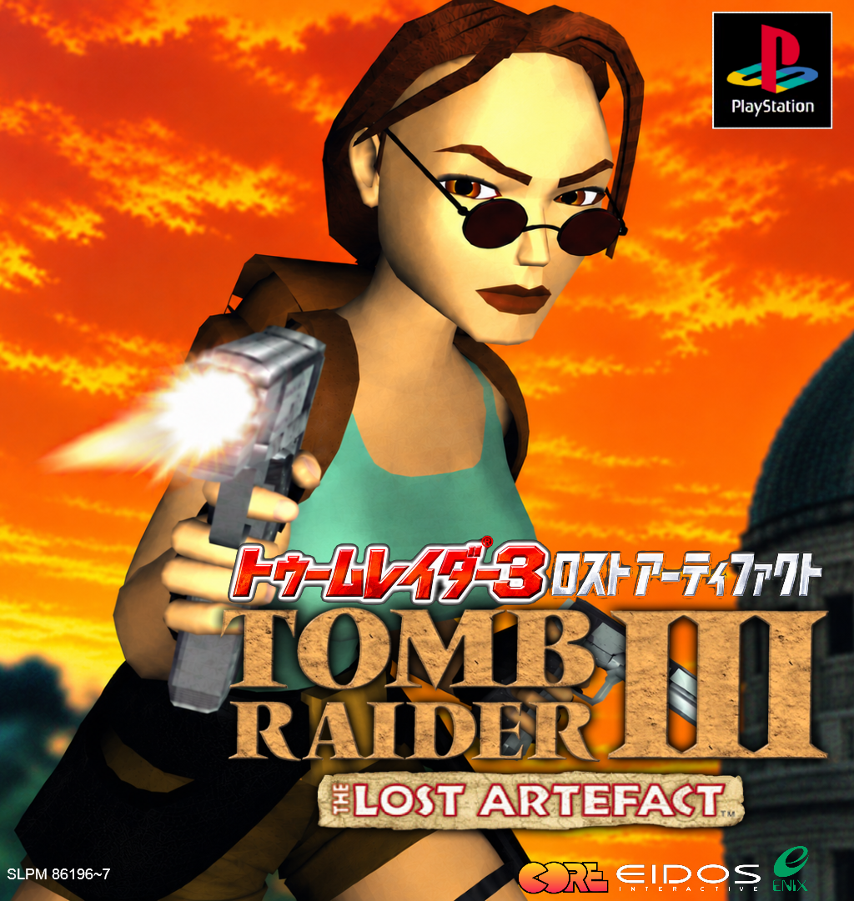

# Tomb Raider III: The Lost Artefact (PS1)

> **No game data is included in this repository.** The levels, sounds, speech, videos, executables
> and texts of Tomb Raider III and The Lost Artefact belong to their rights holders. To play, build the
> disc image from your own games with the disc builder (see "Playing it" below).
> The conversion pipeline described here needs those files in their places (`levels/in`, `disc/files`,
> `bin/orig` and so on), taken from your own copies.

The Lost Artefact on the PlayStation: all six levels (Sleeping with the Fishes in two parts), running on the original Tomb Raider III PS1 engine, for every release of the PS1 game - USA, Europe, Germany, France, Italy, Spain, Japan and Asia, Rev 0 to Rev 2, Disc 1 and 2. The port is finished and playable from start to end.

## Playing it

Download the **disc builder** from the [Releases](https://github.com/Snake356/tr3-lost-artefact-psx/releases) page (Windows 10/11). It makes the PS1 disc image from your own copies of both games:

- your **Tomb Raider III PS1 disc image** (.bin/.cue, .iso or .zip); your disc decides the language;
- your **Lost Artefact PC files**: the Tomb Raider III Gold / Lost Artefact CD (any language, as a disc image or installed), Tomb Raider I-III Remastered, or a TRX installation.

Options: blood colour, level select on New Game, and NTSC (60 Hz) for the European discs (with the US disc as well, any revision: Rev 0, 1 or 2). The players' readme (`tools/builder/package/README.txt`) explains everything; `tools/builder/package/CHANGES.txt` lists what differs from the PC version and why, the known issues and every fixed bug.

  
  

The builder also puts a cover next to the disc image for emulator frontends, designed by XeNoN3560. The NTSC-J cover is based on the orange cover of the Japanese PC release of The Lost Artefact. The covers are optional: anyone can use their own instead.

<table align="center">
  <tr>
    <td align="center"></td>
    <td align="center"></td>
    <td align="center"></td>
  </tr>
  <tr>
    <td align="center"><b>PAL</b> Europe</td>
    <td align="center"><b>NTSC-U</b> USA</td>
    <td align="center"><b>NTSC-J</b> Japan and Asia</td>
  </tr>
</table>

Found a problem? Use **Report a problem** in the builder or [open an issue](https://github.com/Snake356/tr3-lost-artefact-psx/issues).

## History and credits

- **b122251** made the PS1 port and published the whole project at https://gitlab.com/b122251/tr3gpsx with the request to finish it (his original readme and farewell are there). The end credits close with the farewell message he left for the Tomb Raider community.
- **FindingTheLost** (April to September 2025) carried it on: he found that Sleeping with the Fishes was too big for the PS1's 2 MB of memory once several enemies became active and split it into two parts, and he fixed a camera in Willard's Lair, the secret counts, save crystals and the loading screens.
- **XeNoN3560** (from September 2026) continued from FindingTheLost's work and finished it: Reunion playable (the acid and Sophia's fuse box), the Japanese and Asian discs with easier Disc 1 levels made by hand and Japanese texts, the remaining level fixes, the start-up and end credits like the original game, and the disc builder.

`split_info.txt` is the full development log, `tools/builder/package/CHANGES.txt` the player-facing list of changes.

Claude (Anthropic) was used as an AI assistant to help finish the project.

Tools used for the continuation: TRForge Level Editor (level fixes) and mkpsxiso by Lameguy64 (GPL-2.0, `tools/src/mkpsxiso`), which writes the disc images. Tomb Raider III and The Lost Artefact (c) Core Design / Eidos Interactive; the rights are now held by Crystal Dynamics. This is a non-commercial fan project, not affiliated with or endorsed by them.

## Repository layout

| Folder | Contents |
|---|---|
| `levels/` | `convert.sh` (the level conversion), `geom/` (per-level geometry fixes), `japan/` (the Japan/Asia Disc 1 changes), `mesh/`, `anims/`, `textures/` |
| `tools/src/` | the sources of the converter and tools (`tr3pcpsx`, `trmod`, `texmod`, `tric`, `mkpsxiso`, ...) |
| `tools/` | Python helpers (Japanese texts and Kanji, NTSC executable, sky dome tip, model and room tools) |
| `tools/builder/` | the disc builder (`gui.py` window, `build.py` command line) and its data |
| `bin/patches/` | IPS patches for the game executable of every release (`bin/patch.sh` lists the applied ones) |
| `disc/` | the disc layouts for mkpsxiso, one per release |
| `tombpsx/` | the game texts and gameflow (TOMBPSX.DAT) |
| `art/` | loading screens, title, legal and credit pictures, Kanji font |
| `guides/` | b122251's guides to the project and its tools (start with `tool_info.txt`), cheat codes (`cheats.txt`) |

## Building from source

Only needed to change the project itself; players use the disc builder. Build on Windows (Git Bash, MinGW gcc, Python 3):

    py -3 tools/windows_build.py [--levels scotland,zoo] [--versions us,jp] [--out DIR]

It compiles all tools from `tools/src` into `build/win/bin`, runs `levels/convert.sh` in `build/win/levels` and writes the converted levels to `build/win/result/out/<version>/`, plus the processed PC levels (`*.tr2`, e.g. for TRView). Compare the results and copy them to `levels/out` yourself.

- The Japanese and Asian Disc 1 (`jp`, `as`) get their easier levels from `levels/japan/<level>.txt` (see `tools/make_japan_commands.py`; after editing a finished Japan level, generate the file again from the converter's `<level>.tr2` and the Japan level).
- `tools/build_japan_disc.py [--level-select]` builds the jp/as disc images into `build/japan`.
- Any disc image by hand: `mkpsxiso -y disc/<layout>.xml`.
- Further tools: `tools/make_jp_gameflow.py`, `tools/make_region_dat.py`, `tools/make_kanji_la.py`, `tools/make_ntsc_exe.py`, `tools/close_dome_tip.py`, `bin/patch.sh` (IPS patches).

### Updating the disc builder

The builder ships no game data: the project's levels, textures, animations, meshes and texts are stored as differences to the player's own files. After changing any of them, rebuild `levels/out` as above, then

    python tools/builder/make_data.py <sources.json>
    python tools/builder/build_exe.py <out folder>

`make_data.py` renews the difference files from the original PC and PS1 files listed in `sources.json` (`{"pc": [...], "ps1": [...]}`, kept outside the repository) and checks that the builder gives exactly `levels/in`, the texts and all of `levels/out`. `build_exe.py` makes the single Windows EXE (PyInstaller) and the download folder.
